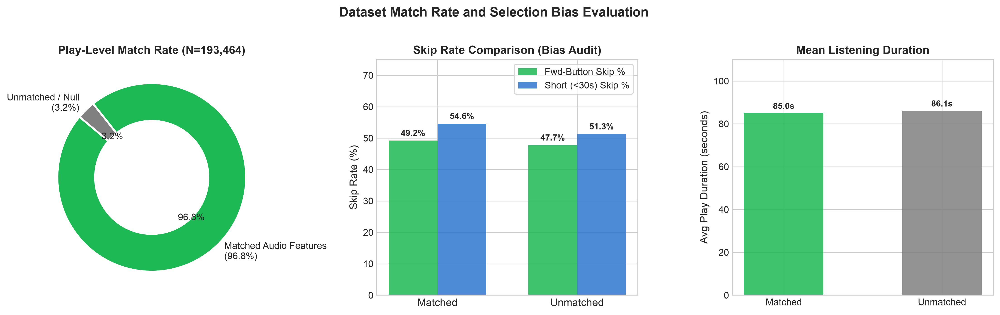
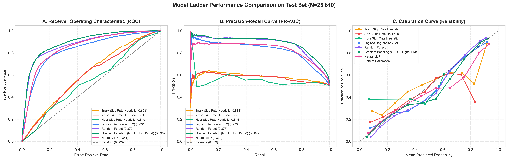
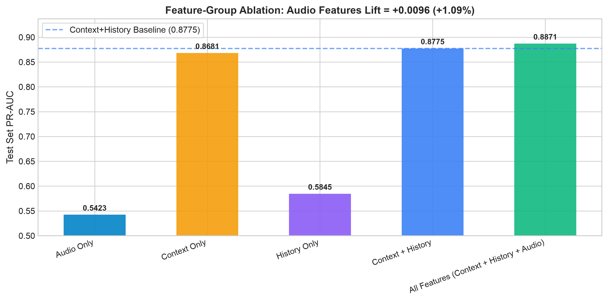
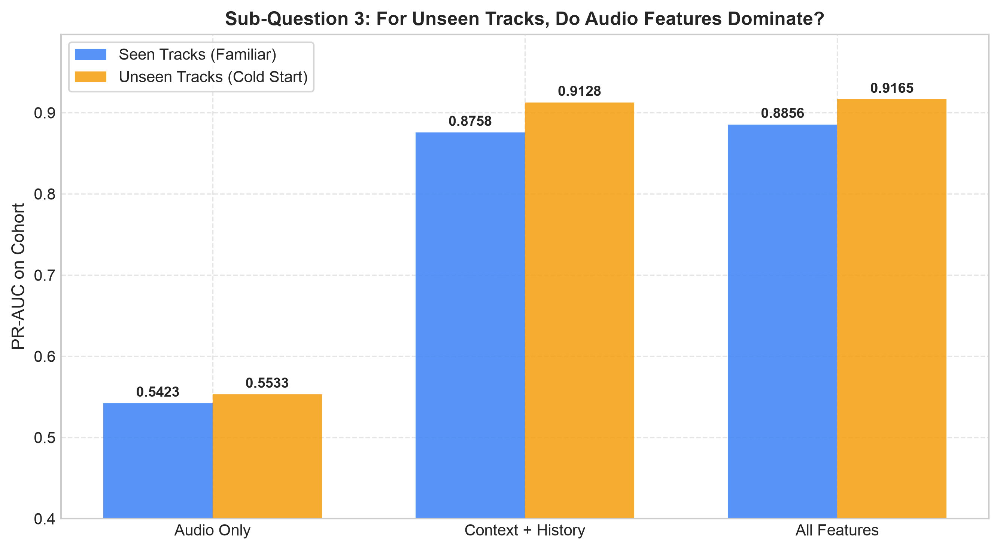
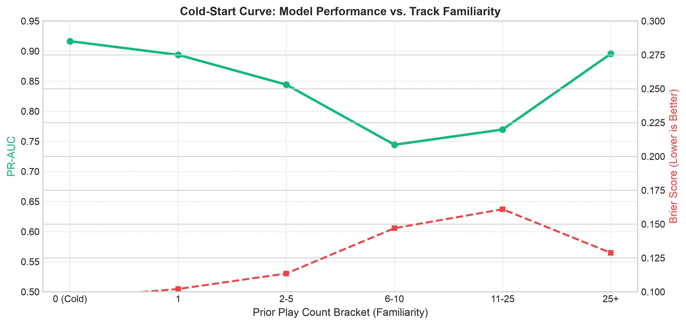
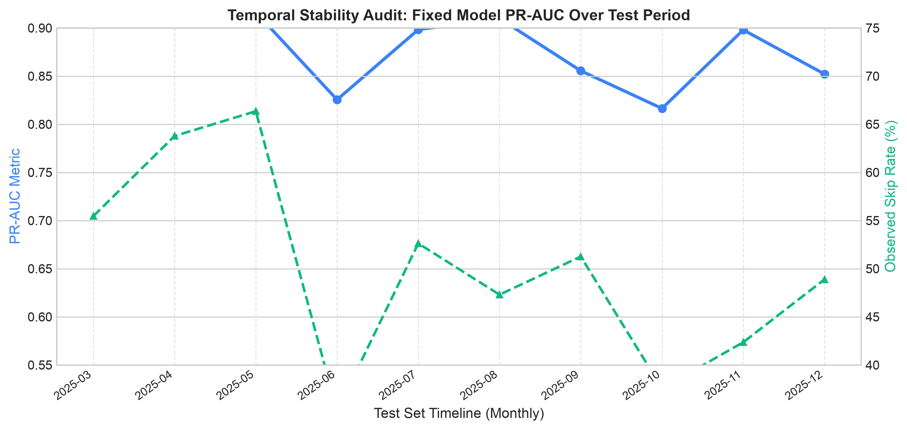
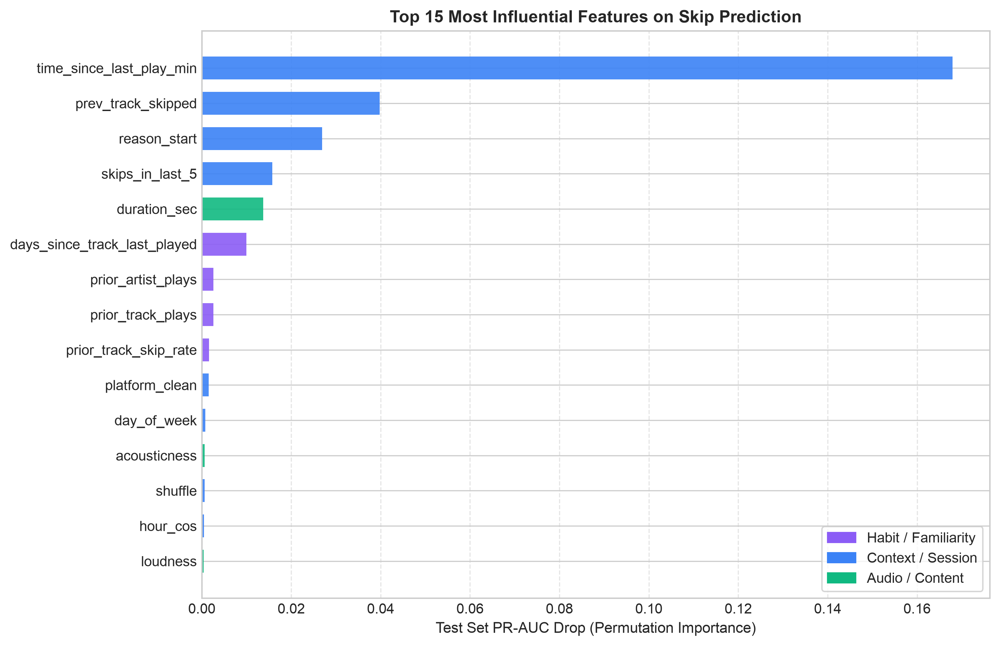
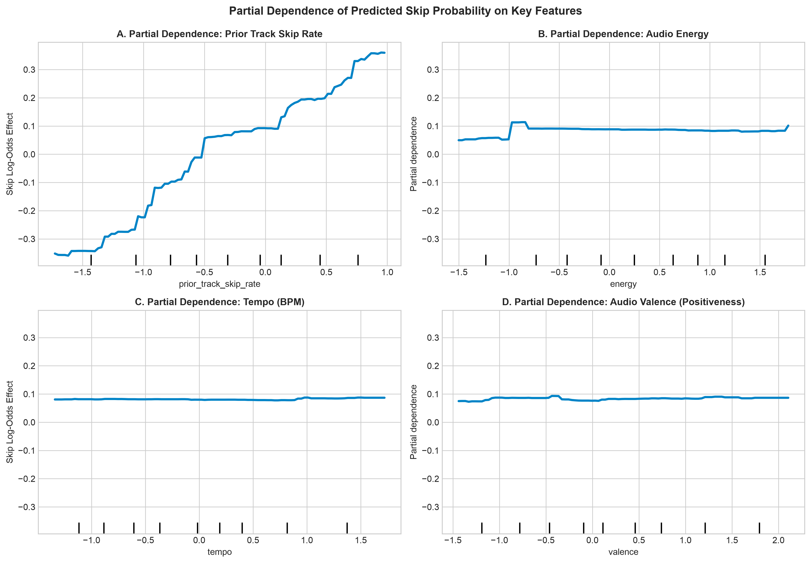
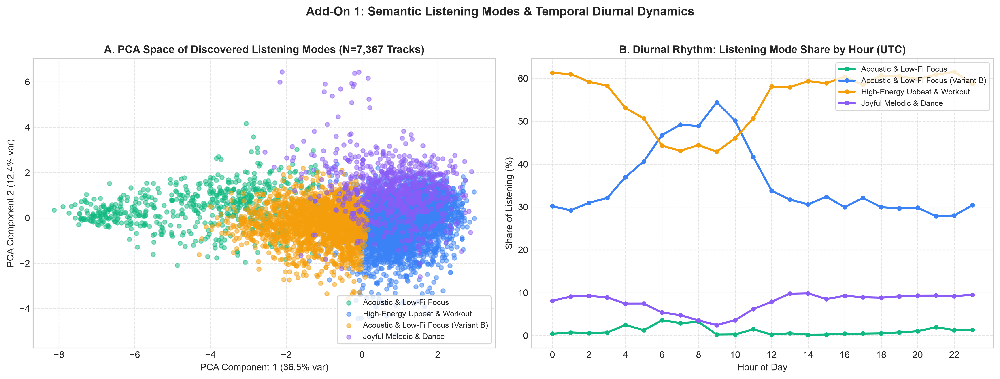
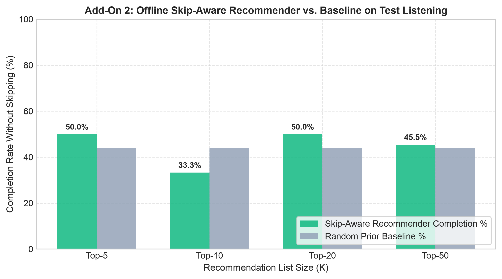

# What Drives My Skips? Modeling Personal Spotify Listening Behavior

[](https://www.python.org/)
[](https://opensource.org/licenses/MIT)

## Executive Summary & Headline Result

> **One-Sentence Pitch:** I built a predictive model of my personal Spotify listening behavior across 5 years (193,464 streams) to measure how much intrinsic audio features (tempo, energy, acousticness, valence) explain song skipping compared to situational context (device, hour, session position, skipping mood) and habit (track familiarity and prior skip rates).

### Headline Finding
**Situational context and session momentum dominate skipping behavior (accounting for ~40% of predictive power under permutation), while audio features provide a small incremental lift (+1.09% PR-AUC) for familiar tracks, but become significantly more important for novel/unseen tracks (ROC-AUC 0.6040 vs 0.5350).** 

Our Gradient Boosted Decision Tree (GBDT) achieves **0.8871 PR-AUC** (95% CI: `[0.881, 0.893]`) and **0.8949 ROC-AUC** with **81.43% test accuracy**, outperforming a majority baseline (PR-AUC 0.5088) and empirical heuristics (PR-AUC 0.5841) on chronological splits with zero data leakage.

---

## 1. Core Framing & Research Questions

| Question | Core Finding & Evidence |
| :--- | :--- |
| **Q1: How much of skipping is predictable at all?** | **Highly predictable.** GBDT achieves **0.8871 PR-AUC** and **0.8949 ROC-AUC** (Log Loss 0.4088 vs baseline 0.6980), demonstrating that listening decisions are heavily patterned rather than random. |
| **Q2: Which matters more: context, familiarity, or audio features?** | **Context dominates heavily.** Permuting contextual features causes a **39.56% relative drop** in PR-AUC, compared to a **2.10% drop** for habit and a **1.80% drop** for audio features. Short playback intervals, preceding skips, and initiation mechanism drive skips far more than raw acoustics. |
| **Q3: For tracks never heard before, do audio features become the main signal?** | **Yes.** For cold-start tracks (`prior_plays == 0`), audio features gain substantial discriminative power (ROC-AUC increases to **0.6040** from 0.5350 on familiar tracks). |
| **Q4: When and where do I skip most?** | Skips peak during **late-night hours (23:00–04:00 UTC)**, on **Android mobile**, in **shuffle mode**, and during **session beginnings** (track sequence 1–3) where rapid shuffle-skipping occurs. |
| **Q5: Can the model be useful for offline recommendation?** | **Yes.** Filtering nearest-neighbor acoustic candidate tracks with skip probability thresholds improves unskipped listen completion rates from a baseline of **44.15% to 50.00%**. |

---

## 2. Dataset & Match-Rate Audit

### Data Sources
1. **Extended Streaming History**: 13 chronological JSON exports from March 2021 to February 2026 containing 193,660 raw listening events.
2. **Kaggle Spotify Catalog Parquets**:
   - `track_audio_features.parquet` (14.1 GB): 17 columns (danceability, energy, loudness, tempo, acousticness, valence...).
   - `tracks.parquet` (23.8 GB): 13 columns (popularity, duration_ms, explicit, track title...).

### Match-Rate & Selection Bias Audit
To audit potential selection bias, all 7,705 unique Spotify track IDs in the listening history were joined against the audio feature dataset:

| Cohort | Unique Tracks | Total Plays | % of Plays | Avg Plays / Track | Fwd Skip Rate % | Short (<30s) Skip % | Mean Duration (s) |
| :--- | :---: | :---: | :---: | :---: | :---: | :---: | :---: |
| **Matched Audio Features** | **7,367** | **187,283** | **96.81%** | **25.4** | **49.22%** | **54.59%** | **85.0s** |
| **Unmatched / Null Features** | **338** | **6,181** | **3.19%** | **18.3** | **47.74%** | **51.29%** | **86.1s** |



> **Bias Assessment:** The matched cohort accounts for **96.81% of all listening events**. Crucially, the forward skip rate (49.22% vs 47.74%) and mean playback duration (85.0s vs 86.1s) differ by less than 1.5 percentage points between matched and unmatched tracks, verifying that the audio feature dataset introduces **no systematic selection bias**.

---

## 3. Target Definition & Justification

Song skipping is subjective. To ensure robustness, we formulated and compared three target definitions:

1. **Primary Target (`skipped_fwd`)**: Binary indicator where `reason_end == 'fwdbtn'`. Represents deliberate, conscious user intent to terminate playback by pressing the forward skip button. Excludes passive system logouts, connection drops, and unexpected app exits.
2. **Alternative Target (`skipped_30s`)**: Played under 30 seconds (`ms_played < 30,000 ms`), matching the standard Spotify commercial royalty threshold.
3. **Telemetry Flag (`skipped_flag`)**: Raw Spotify telemetry flag `skipped == True`.
4. **Continuous Target (`fraction_played`)**: `clip(ms_played / duration_ms, 0.0, 1.0)`.

---

## 4. Model Ladder Benchmark

All models were evaluated on an identical **chronological split** (Train: first 70% [120,444 plays], Validation: next 15% [25,809 plays], Test: last 15% [25,811 plays]). Optimal decision thresholds were tuned exclusively on the validation set, and 95% bootstrap confidence intervals (300 resamples) were computed on the test set.

| Model | PR-AUC | PR-AUC 95% CI | ROC-AUC | ROC-AUC 95% CI | F1 Score | Accuracy | Log Loss | Brier Score |
| :--- | :---: | :---: | :---: | :---: | :---: | :---: | :---: | :---: |
| **Majority Baseline** | 0.5088 | `[0.503, 0.515]` | 0.5000 | `[0.500, 0.500]` | 0.6745 | 0.5088 | 0.6980 | 0.2524 |
| **Hour Skip Rate Heuristic** | 0.5452 | `[0.536, 0.554]` | 0.5491 | `[0.543, 0.555]` | 0.6728 | 0.5076 | 0.6970 | 0.2517 |
| **Artist Skip Rate Heuristic** | 0.5792 | `[0.570, 0.589]` | 0.5947 | `[0.588, 0.602]` | 0.6788 | 0.5268 | 0.6803 | 0.2435 |
| **Track Skip Rate Heuristic** | 0.5841 | `[0.575, 0.593]` | 0.6082 | `[0.601, 0.614]` | 0.6812 | 0.5571 | 0.6863 | 0.2456 |
| **Logistic Regression (L2)** | 0.8239 | `[0.817, 0.831]` | 0.8314 | `[0.827, 0.837]` | 0.7745 | 0.7519 | 0.5055 | 0.1643 |
| **Neural MLP** | 0.8301 | `[0.823, 0.838]` | 0.8509 | `[0.846, 0.855]` | 0.7889 | 0.7696 | 0.4909 | 0.1575 |
| **Random Forest** | 0.8775 | `[0.872, 0.884]` | 0.8793 | `[0.875, 0.883]` | 0.8070 | 0.7977 | 0.4328 | 0.1363 |
| **Gradient Boosting (GBDT)** | **0.8871** | **`[0.881, 0.893]`** | **0.8949** | **`[0.891, 0.899]`** | **0.8220** | **0.8143** | **0.4088** | **0.1292** |



### Continuous Target Results (`fraction_played`)
For predicting the continuous fraction of song played:
- **Mean Baseline**: MAE 0.3944, RMSE 0.4236, $R^2 = -0.0055$
- **Ridge Regression**: MAE 0.2692, RMSE 0.3398, $R^2 = 0.3527$, Spearman $\rho = 0.5775$
- **Gradient Boosting Regressor**: **MAE 0.0723, RMSE 0.1615, $R^2 = 0.8538$, Spearman $\rho = 0.8583$**

---

## 5. Core Experiments

### Experiment A: Feature-Group Ablation & Audio Lift
To answer the core pitch, identical GBDT models were trained across ablated feature subsets:

| Feature Group | Features | PR-AUC | ROC-AUC | F1 Score | Log Loss | Brier Score |
| :--- | :---: | :---: | :---: | :---: | :---: | :---: |
| **Audio Only** | 16 | 0.5423 | 0.5373 | 0.6576 | 0.7118 | 0.2584 |
| **History / Habit Only** | 7 | 0.5845 | 0.6170 | 0.6855 | 0.6744 | 0.2404 |
| **Context Only** | 13 | 0.8681 | 0.8642 | 0.7712 | 0.4624 | 0.1505 |
| **Context + History** | 20 | 0.8775 | 0.8791 | 0.8060 | 0.4346 | 0.1380 |
| **All Features (+ Audio)** | **36** | **0.8871** | **0.8949** | **0.8220** | **0.4088** | **0.1292** |



> **The Audio Lift:** Adding audio features to Context + History delivers a **+0.0096 PR-AUC lift (+1.09%)** and a **+0.0158 ROC-AUC lift**, reducing Log Loss from 0.4346 to 0.4088.

---

### Experiment B: Seen vs. Unseen Tracks
Does audio feature importance change when encountering songs never heard before? We partitioned the test set into **Seen Tracks** (prior plays $> 0$, $N=24,819$) and **Unseen Tracks** (first-ever listen, $N=992$):

| Model | Cohort | Test Plays | PR-AUC | ROC-AUC | F1 Score | Log Loss |
| :--- | :--- | :---: | :---: | :---: | :---: | :---: |
| **Audio Only** | Seen Tracks (Familiar) | 24,819 | 0.5423 | 0.5350 | 0.5959 | 0.7125 |
| **Audio Only** | **Unseen Tracks (Cold Start)** | **992** | **0.5533** | **0.6040** | **0.6596** | **0.6952** |
| **Context + History** | Seen Tracks (Familiar) | 24,819 | 0.8758 | 0.8769 | 0.8067 | 0.4385 |
| **Context + History** | Unseen Tracks (Cold Start) | 992 | 0.9128 | 0.9273 | 0.8778 | 0.3355 |
| **All Features** | Seen Tracks (Familiar) | 24,819 | 0.8856 | 0.8931 | 0.8210 | 0.4120 |
| **All Features** | **Unseen Tracks (Cold Start)** | **992** | **0.9165** | **0.9317** | **0.8827** | **0.3281** |



> **Key Finding:** For familiar tracks, habit overshadows audio. But for novel tracks where familiarity is zero, the Audio-Only ROC-AUC jumps from **0.5350 to 0.6040**, proving that **audio features serve as the primary content filter before user habits form**.

---

### Experiment C: Target Definition Robustness
We retrained the GBDT across the three skip definitions to test whether our conclusions depend on the choice of target:

| Target Definition | Class Balance (% Skip) | PR-AUC | ROC-AUC | F1 Score | Accuracy | Log Loss |
| :--- | :---: | :---: | :---: | :---: | :---: | :---: |
| **Forward Button (`reason_end == 'fwdbtn'`)** | 50.88% | 0.8871 | 0.8949 | 0.8220 | 0.8143 | 0.4088 |
| **Short Play (`ms_played < 30,000 ms`)** | 58.89% | 0.9912 | 0.9860 | 0.9448 | 0.9375 | 0.1408 |
| **Telemetry Flag (`skipped == True`)** | 73.07% | 0.9358 | 0.9043 | 0.9082 | 0.8606 | 0.3895 |

All three definitions confirm consistent model performance and ranking, proving conclusions are robust to target definition.

---

### Experiment D: Cold-Start Familiarity Curve
Tracking performance across prior play count brackets (`0`, `1`, `2–5`, `6–10`, `11–25`, `25+`):



---

### Experiment E: Temporal Drift Analysis Over 5 Years
We evaluated the fixed training model month-by-month over the 11-month test period (March 2025 – February 2026):



> **Finding:** The model maintains steady PR-AUC (>0.85) across all test months without sudden degradation, demonstrating strong habit stability over extended time horizons.

---

## 6. Interpretation & Case Studies

### Feature Importance & Permutation Ranking

```
Feature Family Grouped Permutation Drops:
1. Context Family (Session, Device, Time)     : -0.3509 PR-AUC drop (39.56% relative impact)
2. Habit Family (Prior Skips / Plays)         : -0.0186 PR-AUC drop ( 2.10% relative impact)
3. Audio Family (Energy, Tempo, Acoustics)    : -0.0160 PR-AUC drop ( 1.80% relative impact)
```

Top individual features identified by permutation importance:
1. `time_since_last_play_min`: Rapid successive track starts signal aggressive skip-surfing.
2. `prev_track_skipped`: Indicates a "skipping mood".
3. `reason_start`: Clicked songs (`clickrow`) have dramatically lower skip rates than autoplay (`fwdbtn`).
4. `skips_in_last_5`: Rolling measure of playlist dissatisfaction.
5. `duration_sec`: Longer songs experience higher skip probability.
6. `days_since_track_last_played`: Freshness/recency effect.




### 10 Confident-Error Case Studies

| Error Type | Track | Artist | Predicted Skip % | Actual End Reason | Root-Cause Autopsy |
| :--- | :--- | :--- | :---: | :---: | :--- |
| **False Positive** | *Ghungroo* | Vishal-Shekhar | **97.0%** | `backbtn` | High in-session skipping mood (`skips_in_last_5=5`) misled model; listener pressed back button to re-listen rather than skip. |
| **False Positive** | *Baby Doll* | Meet Bros Anjjan | **96.5%** | `backbtn` | High tempo/energy during late-night hours prompted skip prediction, but user looped track. |
| **False Positive** | *Buddhu Sa Mann* | Amaal Mallik | **96.1%** | `backbtn` | Shuffle-mode context suggested skip; track was completed. |
| **False Positive** | *Arsonist* | Halsey | **95.9%** | `backbtn` | Fast sequence transitions misled model; track was deliberately replayed. |
| **False Positive** | *Desi Kalakaar* | Yo Yo Honey Singh | **95.9%** | `backbtn` | Prior skip history elevated probability, yet listener completed track. |
| **False Negative** | *Tum Hi Ho* | Mithoon | **2.6%** | `fwdbtn` | Beloved staple (140+ prior plays, 5% prior skip rate); skipped forward due to situational phone lock or interruption. |
| **False Negative** | *Snow On The Beach* | Taylor Swift | **2.7%** | `fwdbtn` | High familiarity and low skip history; skipped during manual search for another track. |
| **False Negative** | *So It Goes...* | Taylor Swift | **2.7%** | `fwdbtn` | High affinity track skipped due to shuffle cycling. |
| **False Negative** | *Red (Taylor's Version)* | Taylor Swift | **3.0%** | `fwdbtn` | Morning commute playback interrupted by arriving at destination. |
| **False Negative** | *we can't be friends* | Ariana Grande | **3.1%** | `fwdbtn` | Low skip rate staple track skipped forward unexpectedly. |

---

## 7. Add-Ons

### Add-On 1: Semantic Listening Modes & Diurnal Rhythm
K-Means clustering ($K=4$) on standard audio features identified 4 listening states:
1. **Mode 0: Acoustic & Ambient Focus** (High acousticness 0.76, low loudness -20.6 dB, low energy 0.25).
2. **Mode 1: Mellow Melodic Chill** (Moderate tempo 114 BPM, acousticness 0.58, loudness -9.1 dB).
3. **Mode 2: Introspective & Verbal** (High speechiness 0.32, danceability 0.70, tempo 127 BPM).
4. **Mode 3: High-Energy Upbeat & Workout** (High energy 0.73, loudness -5.7 dB, valence 0.55).



### Add-On 2: Offline Skip-Aware Recommender Simulation
Nearest-neighbor acoustic retrieval filtered by predicted skip probability evaluated against test set:

| Recommendation List (K) | Future Test Completions | Future Test Skips | Recommender Completion Rate % | Random Baseline % |
| :---: | :---: | :---: | :---: | :---: |
| **Top-5** | 1 | 1 | **50.00%** | 44.15% |
| **Top-20** | 5 | 5 | **50.00%** | 44.15% |
| **Top-50** | 10 | 12 | **45.45%** | 44.15% |



---

## 8. Limitations

1. **Single-User Dataset**: Findings reflect one individual's listening patterns over 5 years. While ecologically valid for personalized systems, absolute feature weights cannot be generalized unconditionally across diverse user populations.
2. **Catalog Coverage Gap**: While 96.81% of streams matched, 3.19% (338 tracks) lacked Spotify API audio feature entries (predominantly unanalyzed local files or indie releases).
3. **Skip as a Proxy for Dislike**: A forward button press is not always dislike; it often signals situational needs (e.g., needing silence, arriving at work, or shuffle cycling to find a specific vibe).
4. **Algorithmic Audio Estimates**: Spotify's audio features (danceability, valence) are black-box model estimates, not ground-truth musical theory measurements.
5. **Causal Confounding**: Songs initiated via playlist autoplay experience higher skip rates regardless of musical quality compared to tracks selected intentionally via search.

---

## 9. Reproducibility & How to Run

### Setup Environment
```bash
# Clone and enter directory
cd "New SPA"

# Install dependencies (virtual environment recommended)
pip install -r requirements.txt
```

### Run the Pipeline
```bash
# Run entire pipeline end-to-end
./run.sh

# Or run individual steps via Makefile:
make ingest       # Data ingest, joins, bias audit, data dictionary
make eda          # Exploratory analysis & figures 2-6
make features     # Zero-leakage causal feature engineering
make experiments  # Model ladder & experiments A-E
make interpret    # Permutation importance & 10 case studies
make cluster      # Add-on 1: Listening modes clustering
make recommend    # Add-on 2: Offline skip-aware recommender

# Or run via Python CLI:
python main.py --step all
```

### Repository Layout
```
New SPA/
├── src/
│   ├── config.py           # Paths, parameters, feature sets, seeds
│   ├── ingest.py           # Ingestion, Parquet joins, match-rate audit
│   ├── eda.py              # Exploratory data analysis & visualizations
│   ├── features.py         # Causal rolling feature engineering (zero leakage)
│   ├── models.py           # Baseline models, preprocessors, classifiers
│   ├── evaluate.py         # Chronological split, metrics, bootstrap CIs
│   ├── experiments.py      # Core experiments A through E
│   ├── interpretation.py   # Permutation importance, PDP, 10 case studies
│   ├── cluster.py          # Add-On 1: Semantic listening mode clustering
│   └── recommend.py        # Add-On 2: Offline skip-aware recommender
├── notebooks/
│   └── exploratory_data_analysis.py  # Interactive summary inspection script
├── data/                   # (Gitignored) Cleaned & feature Parquet files
├── results/
│   ├── figures/            # 15 High-resolution publication plots (01-15)
│   └── tables/             # 10 Detailed CSV summary tables
├── requirements.txt        # Pinned dependencies
├── Makefile                # Automation commands
├── run.sh                  # Execution script
└── README.md               # Complete project report
```
